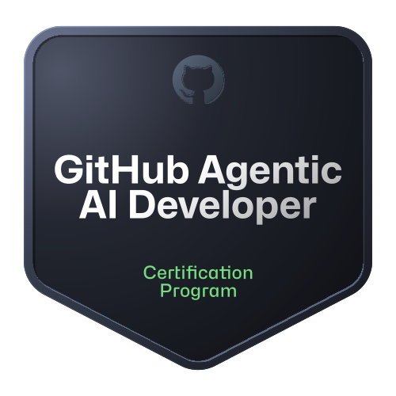
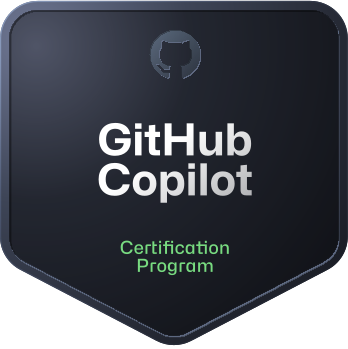
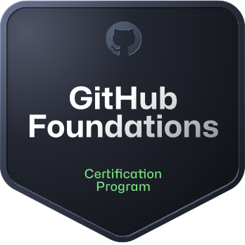
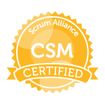

🇺🇸 [English](README.md)

## こんにちは、福岡の Shinba（a-shinba）です！👋
### 「アキ」または「シンバ」と呼んでください ☺️

GitHub、GitHub Copilot、Microsoft Azure を活用し、開発者や組織の生産性向上を支援しています。GitHub が大好きです！

🌟 **専門分野**
- 🔥 GitHub・GitHub Copilot／エージェント型 AI
- 🔥 DevOps・GitHub Actions
- 🔥 アプリケーションセキュリティ（GitHub Advanced Security、Microsoft Security）
- 🔥 Microsoft Azure／Microsoft 365
- 🔥 開発者生産性

🚀 **これまでのコミュニティ・執筆活動**
- **Alternative Architecture Dojo**（`#AADOJO`）主催
- **GitHub Dockyard**（`#GitHubDockyard`）主催
- 技術ブログ [AADOJO](https://aadojo.alterbooth.com/) の元編集者
- [GitHub Japan Blog](https://github.blog/jp/) への協力
- [Zenn](https://zenn.dev/shinbaz) での記事執筆

🎓 **教育・トレーニング**
教育機関や学生向けに、GitHub を使った開発体験プログラムや研修を提供しています。お気軽にご相談ください！

🌐 **リンク**
- X：[@shinbaz](https://x.com/shinbaz)
- LinkedIn：[Akitaka Shinba](https://www.linkedin.com/in/akitaka-shinba-b627aa52/)

💬 **GitHub や GitHub Copilot について、お気軽にご質問ください！** 🚀

---

## 🏅 保有資格

GitHub 認定 **6 件** · Microsoft 認定 **17 件**（エキスパート **4 件**・アソシエイト **12 件**・スペシャリティ **1 件**）· 認定スクラムマスター

### GitHub
<table>
  <tr><th>バッジ</th><th>資格名</th><th>試験番号</th><th>試験名</th><th>取得日</th></tr>
  <tr><td align="center"></td><td><a href="https://learn.microsoft.com/ja-jp/credentials/certifications/agentic-ai-developer/">GitHub 認定：エージェント AI 開発者</a></td><td><code>GH-600</code></td><td>エージェント型 AI システムでの開発</td><td>2026年</td></tr>
  <tr><td align="center"></td><td><a href="https://learn.microsoft.com/ja-jp/credentials/certifications/github-actions/">GitHub Actions</a></td><td><code>GH-200</code></td><td>GitHub Actions</td><td>2023年</td></tr>
  <tr><td align="center"></td><td><a href="https://learn.microsoft.com/ja-jp/credentials/certifications/github-advanced-security/">GitHub Advanced Security</a></td><td><code>GH-500</code></td><td>GitHub Advanced Security</td><td>2023年</td></tr>
  <tr><td align="center"></td><td><a href="https://learn.microsoft.com/ja-jp/credentials/certifications/github-copilot/">GitHub Copilot</a></td><td><code>GH-300</code></td><td>GitHub Copilot</td><td>2024年</td></tr>
  <tr><td align="center"></td><td><a href="https://learn.microsoft.com/ja-jp/credentials/certifications/github-administration/">GitHub の管理</a></td><td><code>GH-100</code></td><td>GitHub の管理</td><td>2023年</td></tr>
  <tr><td align="center"></td><td><a href="https://learn.microsoft.com/ja-jp/credentials/certifications/github-foundations/">GitHub の基礎</a></td><td><code>GH-900</code></td><td>GitHub の基礎</td><td>2023年</td></tr>
</table>

### Microsoft
<table>
  <tr><th>バッジ</th><th>資格名</th><th>試験番号</th><th>試験名</th><th>取得日</th></tr>
  <tr><td align="center"></td><td><a href="https://learn.microsoft.com/ja-jp/credentials/certifications/m365-enterprise-administrator/">Microsoft 365 認定：管理者エキスパート</a></td><td nowrap width="100"><code>MS-102</code></td><td>Microsoft 365 管理者</td><td>2026-02-08</td></tr>
  <tr><td align="center"></td><td><a href="https://learn.microsoft.com/ja-jp/credentials/certifications/devops-engineer/">Microsoft 認定：DevOps エンジニア エキスパート</a></td><td nowrap width="100"><code>AZ-400</code></td><td>Microsoft DevOps ソリューションの設計と実装</td><td>2025-01-13</td></tr>
  <tr><td align="center"></td><td><a href="https://learn.microsoft.com/ja-jp/credentials/certifications/cybersecurity-architect-expert/">Microsoft 認定：サイバーセキュリティ アーキテクト エキスパート</a></td><td nowrap width="100"><code>SC-100</code></td><td>Microsoft サイバーセキュリティ アーキテクト</td><td>2024-02-27</td></tr>
  <tr><td align="center"></td><td><a href="https://learn.microsoft.com/ja-jp/credentials/certifications/azure-solutions-architect/">Microsoft 認定：Azure ソリューション アーキテクト エキスパート</a></td><td nowrap width="100"><code>AZ-305</code></td><td>Microsoft Azure インフラストラクチャ ソリューションの設計</td><td>2023-02-24</td></tr>
  <tr><td align="center"></td><td><a href="https://learn.microsoft.com/ja-jp/credentials/certifications/fabric-analytics-engineer-associate/">Microsoft 認定：Fabric Analytics エンジニア アソシエイト</a></td><td nowrap width="100"><code>DP-600</code></td><td>Microsoft Fabric を使用した分析ソリューションの実装</td><td>2026-04-22</td></tr>
  <tr><td align="center"></td><td><a href="https://learn.microsoft.com/ja-jp/credentials/certifications/information-security-administrator/">Microsoft 認定：情報セキュリティ管理者アソシエイト</a></td><td nowrap width="100"><code>SC-401</code></td><td>Microsoft 365 における情報セキュリティの管理</td><td>2025-08-03</td></tr>
  <tr><td align="center"></td><td><a href="https://learn.microsoft.com/ja-jp/credentials/certifications/azure-network-engineer-associate/">Microsoft 認定：Azure ネットワーク エンジニア アソシエイト</a></td><td nowrap width="100"><code>AZ-700</code></td><td>Microsoft Azure ネットワーク ソリューションの設計と実装</td><td>2025-07-11</td></tr>
  <tr><td align="center"></td><td><a href="https://learn.microsoft.com/ja-jp/credentials/certifications/azure-cosmos-db-developer-specialty/">Microsoft 認定：Azure Cosmos DB AI 開発者アソシエイト</a></td><td nowrap width="100"><code>DP-420</code></td><td>Microsoft Azure Cosmos DB を使用したクラウドネイティブ アプリケーションの設計と実装</td><td>2025-04-14</td></tr>
  <tr><td align="center"></td><td><a href="https://learn.microsoft.com/ja-jp/credentials/certifications/azure-data-engineer/">Microsoft 認定：Azure データ エンジニア アソシエイト</a></td><td nowrap width="100"><code>DP-203</code></td><td>Microsoft Azure のデータ エンジニアリング</td><td>2025-04-06</td></tr>
  <tr><td align="center"></td><td><a href="https://learn.microsoft.com/ja-jp/credentials/certifications/azure-data-scientist/">Microsoft 認定：Azure データ サイエンティスト アソシエイト</a></td><td nowrap width="100"><code>DP-100</code></td><td>Azure でのデータ サイエンス ソリューションの設計と実装</td><td>2025-02-15</td></tr>
  <tr><td align="center"></td><td><a href="https://learn.microsoft.com/ja-jp/credentials/certifications/azure-developer/">Microsoft 認定：Azure 開発者アソシエイト</a></td><td nowrap width="100"><code>AZ-204</code></td><td>Microsoft Azure 向けソリューションの開発</td><td>2025-01-07</td></tr>
  <tr><td align="center"></td><td><a href="https://learn.microsoft.com/ja-jp/credentials/certifications/azure-virtual-desktop-specialty/">Microsoft 認定：Azure Virtual Desktop 専門</a></td><td nowrap width="100"><code>AZ-140</code></td><td>Microsoft Azure Virtual Desktop の構成と運用</td><td>2024-06-15</td></tr>
  <tr><td align="center"></td><td><a href="https://learn.microsoft.com/ja-jp/credentials/certifications/azure-ai-engineer/">Microsoft 認定：Azure AI エンジニア アソシエイト</a></td><td nowrap width="100"><code>AI-102</code></td><td>Microsoft Azure AI ソリューションの設計と実装</td><td>2024-05-14</td></tr>
  <tr><td align="center"></td><td><a href="https://learn.microsoft.com/ja-jp/credentials/certifications/security-operations-analyst/">Microsoft 認定：セキュリティ運用アナリスト アソシエイト</a></td><td nowrap width="100"><code>SC-200</code></td><td>Microsoft セキュリティ運用アナリスト</td><td>2024-04-22</td></tr>
  <tr><td align="center"></td><td><a href="https://learn.microsoft.com/ja-jp/credentials/certifications/identity-and-access-administrator/">Microsoft 認定：アイデンティティおよびアクセス管理者アソシエイト</a></td><td nowrap width="100"><code>SC-300</code></td><td>Microsoft ID およびアクセス管理者</td><td>2024-02-05</td></tr>
  <tr><td align="center"></td><td><a href="https://learn.microsoft.com/ja-jp/credentials/certifications/azure-security-engineer/">Microsoft 認定：Azure セキュリティ エンジニア アソシエイト</a></td><td nowrap width="100"><code>AZ-500</code></td><td>Microsoft Azure セキュリティ技術</td><td>2024-01-08</td></tr>
  <tr><td align="center"></td><td><a href="https://learn.microsoft.com/ja-jp/credentials/certifications/azure-administrator/">Microsoft 認定：Azure 管理者アソシエイト</a></td><td nowrap width="100"><code>AZ-104</code></td><td>Microsoft Azure 管理者</td><td>2023-02-05</td></tr>
</table>

### アジャイル
<table>
  <tr><th>バッジ</th><th>資格名</th><th>試験番号</th><th>試験名</th><th>取得日</th></tr>
  <tr><td align="center"></td><td><a href="https://www.scrumalliance.org/get-certified/scrum-master-track/certified-scrummaster">認定スクラムマスター（CSM）</a></td><td><code>—</code></td><td>Scrum Alliance</td><td>2022年</td></tr>
</table>

Microsoft の日付は試験合格日であり、認定資格の取得日とは異なる場合があります。バッジは資格レベル（エキスパート／アソシエイト／スペシャリティ）を表します。認定資格は <a href="https://learn.microsoft.com/ja-jp/users/56324592/transcript/d90jh1r050q2l3d">Microsoft Learn のトランスクリプト</a>で確認できます。
