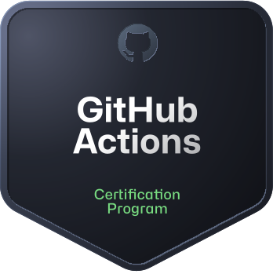
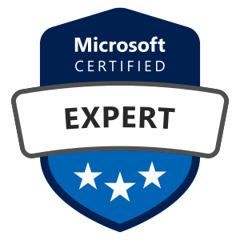
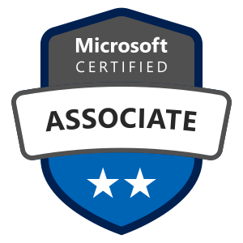
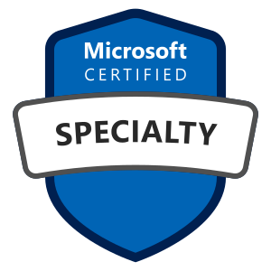

🇺🇸 <a href="README.md">English</a>

## こんにちは、福岡の Shinba（a-shinba）です！👋
### アキ or シンバと呼んでください ☺️

GitHub、GitHub Copilot、Microsoft Azure を活用して、開発者と組織の生産性向上を支援している GitHub ギークです。

🌟 **専門領域**
- 🔥 GitHub・GitHub Copilot／エージェント型AI
- 🔥 DevOps・GitHub Actions
- 🔥 アプリケーションセキュリティ（GitHub Advanced Security、Microsoft Security）
- 🔥 Microsoft Azure／Microsoft 365
- 🔥 開発者生産性

🚀 **コミュニティ・執筆活動歴**
- **Alternative Architecture Dojo**（`#AADOJO`）主催
- **GitHub Dockyard**（`#GitHubDockyard`）主催
- 技術ブログ [AADOJO](https://aadojo.alterbooth.com/) の元編集者
- [GitHub Japan Blog](https://github.blog/jp/) のお手伝い
- [Zenn](https://zenn.dev/shinbaz) で執筆

🎓 **教育**
教育機関・学生向けに、GitHub を使った開発体験プログラムやトレーニングを提供しています。お気軽にお声がけください！

🌐 **リンク**
- X：[@shinbaz](https://x.com/shinbaz)
- LinkedIn：[Akitaka Shinba](https://www.linkedin.com/in/akitaka-shinba-b627aa52/)

💬 **GitHub と GitHub Copilot のことなら、何でも気軽に聞いてください！** 🚀

---

## 🏅 保有資格

GitHub 認定 **6** · Microsoft Expert **4** · Microsoft Associate **12** · Microsoft Specialty **1** · 認定スクラムマスター

### GitHub
<table>
  <tr><th>バッジ</th><th>資格名</th><th>試験番号</th><th>試験名</th><th>取得日</th></tr>
  <tr><td align="center"></td><td><a href="https://learn.microsoft.com/credentials/certifications/agentic-ai-developer/">GitHub Certified: Agentic AI Developer</a></td><td><code>GH-600</code></td><td>Developing in Agentic AI Systems</td><td>2026年</td></tr>
  <tr><td align="center"></td><td><a href="https://learn.microsoft.com/credentials/certifications/github-actions/">GitHub Actions</a></td><td><code>GH-200</code></td><td>GitHub Actions</td><td>2023年</td></tr>
  <tr><td align="center"></td><td><a href="https://learn.microsoft.com/credentials/certifications/github-advanced-security/">GitHub Advanced Security</a></td><td><code>GH-500</code></td><td>GitHub Advanced Security</td><td>2023年</td></tr>
  <tr><td align="center"></td><td><a href="https://learn.microsoft.com/credentials/certifications/github-copilot/">GitHub Copilot</a></td><td><code>GH-300</code></td><td>GitHub Copilot</td><td>2024年</td></tr>
  <tr><td align="center"></td><td><a href="https://learn.microsoft.com/credentials/certifications/github-administration/">GitHub Administration</a></td><td><code>GH-100</code></td><td>GitHub Administration</td><td>2023年</td></tr>
  <tr><td align="center"></td><td><a href="https://learn.microsoft.com/credentials/certifications/github-foundations/">GitHub Foundations</a></td><td><code>GH-900</code></td><td>GitHub Foundations</td><td>2023年</td></tr>
</table>

### Microsoft
<table>
  <tr><th>バッジ</th><th>資格名</th><th>試験番号</th><th>試験名</th><th>取得日</th></tr>
  <tr><td align="center"></td><td><a href="https://learn.microsoft.com/credentials/certifications/m365-enterprise-administrator/">Microsoft 365 Certified: Administrator Expert</a></td><td><code>MS-102</code></td><td>Microsoft 365 Administrator</td><td>2026-02-08</td></tr>
  <tr><td align="center"></td><td><a href="https://learn.microsoft.com/credentials/certifications/devops-engineer/">Microsoft Certified: DevOps Engineer Expert</a></td><td><code>AZ-400</code></td><td>Designing and Implementing Microsoft DevOps Solutions</td><td>2025-01-13</td></tr>
  <tr><td align="center"></td><td><a href="https://learn.microsoft.com/credentials/certifications/cybersecurity-architect-expert/">Microsoft Certified: Cybersecurity Architect Expert</a></td><td><code>SC-100</code></td><td>Microsoft Cybersecurity Architect</td><td>2024-02-27</td></tr>
  <tr><td align="center"></td><td><a href="https://learn.microsoft.com/credentials/certifications/azure-solutions-architect/">Microsoft Certified: Azure Solutions Architect Expert</a></td><td><code>AZ-305</code></td><td>Designing Microsoft Azure Infrastructure Solutions</td><td>2023-02-24</td></tr>
  <tr><td align="center"></td><td><a href="https://learn.microsoft.com/credentials/certifications/fabric-analytics-engineer-associate/">Microsoft Certified: Fabric Analytics Engineer Associate</a></td><td><code>DP-600</code></td><td>Implementing Analytics Solutions Using Microsoft Fabric</td><td>2026-04-22</td></tr>
  <tr><td align="center"></td><td><a href="https://learn.microsoft.com/credentials/certifications/information-security-administrator/">Microsoft Certified: Information Security Administrator Associate</a></td><td><code>SC-401</code></td><td>Administering Information Security in Microsoft 365</td><td>2025-08-03</td></tr>
  <tr><td align="center"></td><td><a href="https://learn.microsoft.com/credentials/certifications/azure-network-engineer-associate/">Microsoft Certified: Azure Network Engineer Associate</a></td><td><code>AZ-700</code></td><td>Designing and Implementing Microsoft Azure Networking Solutions</td><td>2025-07-11</td></tr>
  <tr><td align="center"></td><td><a href="https://learn.microsoft.com/credentials/certifications/azure-cosmos-db-developer-specialty/">Microsoft Certified: Azure Cosmos DB AI Developer Associate</a></td><td><code>DP-420</code></td><td>Designing and Implementing Cloud-Native Applications Using Microsoft Azure Cosmos DB</td><td>2025-04-14</td></tr>
  <tr><td align="center"></td><td><a href="https://learn.microsoft.com/credentials/certifications/azure-data-engineer/">Microsoft Certified: Azure Data Engineer Associate</a></td><td><code>DP-203</code></td><td>Data Engineering on Microsoft Azure</td><td>2025-04-06</td></tr>
  <tr><td align="center"></td><td><a href="https://learn.microsoft.com/credentials/certifications/azure-data-scientist/">Microsoft Certified: Azure Data Scientist Associate</a></td><td><code>DP-100</code></td><td>Designing and Implementing a Data Science Solution on Azure</td><td>2025-02-15</td></tr>
  <tr><td align="center"></td><td><a href="https://learn.microsoft.com/credentials/certifications/azure-developer/">Microsoft Certified: Azure Developer Associate</a></td><td><code>AZ-204</code></td><td>Developing Solutions for Microsoft Azure</td><td>2025-01-07</td></tr>
  <tr><td align="center"></td><td><a href="https://learn.microsoft.com/credentials/certifications/azure-virtual-desktop-specialty/">Microsoft Certified: Azure Virtual Desktop Specialty</a></td><td><code>AZ-140</code></td><td>Configuring and Operating Microsoft Azure Virtual Desktop</td><td>2024-06-15</td></tr>
  <tr><td align="center"></td><td><a href="https://learn.microsoft.com/credentials/certifications/azure-ai-engineer/">Microsoft Certified: Azure AI Engineer Associate</a></td><td><code>AI-102</code></td><td>Designing and Implementing a Microsoft Azure AI Solution</td><td>2024-05-14</td></tr>
  <tr><td align="center"></td><td><a href="https://learn.microsoft.com/credentials/certifications/security-operations-analyst/">Microsoft Certified: Security Operations Analyst Associate</a></td><td><code>SC-200</code></td><td>Microsoft Security Operations Analyst</td><td>2024-04-22</td></tr>
  <tr><td align="center"></td><td><a href="https://learn.microsoft.com/credentials/certifications/identity-and-access-administrator/">Microsoft Certified: Identity and Access Administrator Associate</a></td><td><code>SC-300</code></td><td>Microsoft Identity and Access Administrator</td><td>2024-02-05</td></tr>
  <tr><td align="center"></td><td><a href="https://learn.microsoft.com/credentials/certifications/azure-security-engineer/">Microsoft Certified: Azure Security Engineer Associate</a></td><td><code>AZ-500</code></td><td>Microsoft Azure Security Technologies</td><td>2024-01-08</td></tr>
  <tr><td align="center"></td><td><a href="https://learn.microsoft.com/credentials/certifications/azure-administrator/">Microsoft Certified: Azure Administrator Associate</a></td><td><code>AZ-104</code></td><td>Microsoft Azure Administrator</td><td>2023-02-05</td></tr>
</table>

### アジャイル
<table>
  <tr><th>バッジ</th><th>資格名</th><th>試験番号</th><th>試験名</th><th>取得日</th></tr>
  <tr><td align="center"></td><td><a href="https://www.scrumalliance.org/get-certified/scrum-master-track/certified-scrummaster">Certified ScrumMaster® (CSM)</a></td><td><code>—</code></td><td>Scrum Alliance</td><td>2022年</td></tr>
</table>

Microsoft の日付は試験合格日であり、資格の取得日とは異なる場合があります。バッジは資格レベル（Expert／Associate／Specialty）を表します。資格の真正性は <a href="https://learn.microsoft.com/ja-jp/users/56324592/transcript/d90jh1r050q2l3d">Microsoft Learn のトランスクリプト</a>で確認できます。
