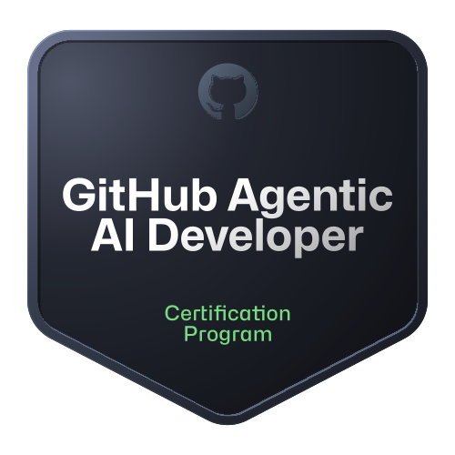
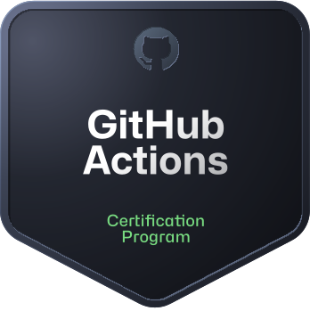
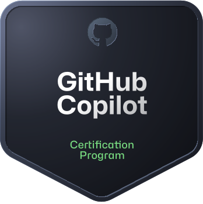
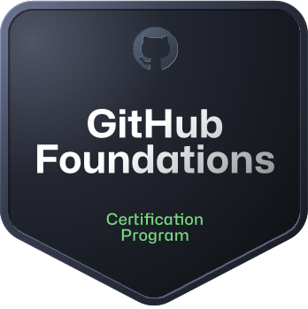
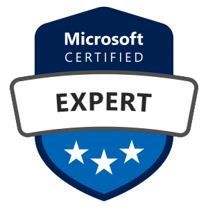
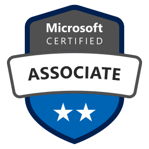
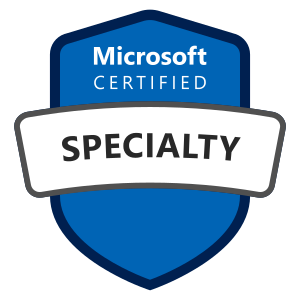
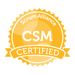

🇯🇵 [日本語はこちら](README.ja.md)

## Hi there, I'm Shinba (a-shinba) from Fukuoka, Japan! 👋
### Call me Aki or Shinba ☺️

GitHub geek helping developers and organizations get the most out of GitHub, GitHub Copilot, and Microsoft Azure.

🌟 **Areas of Expertise**
- 🔥 GitHub & GitHub Copilot / Agentic AI
- 🔥 DevOps & GitHub Actions
- 🔥 Application Security (GitHub Advanced Security, Microsoft Security)
- 🔥 Microsoft Azure / Microsoft 365
- 🔥 Developer Productivity

🚀 **Community & Writing (Past and Present)**
- Organized **Alternative Architecture Dojo** `#AADOJO`
- Organized **GitHub Dockyard** `#GitHubDockyard`
- Former editor of the tech blog [AADOJO](https://aadojo.alterbooth.com/)
- Contributions to the [GitHub Japan Blog](https://github.blog/jp/)
- Articles on [Zenn](https://zenn.dev/shinbaz)

🎓 **Education**
I provide GitHub-based development experience programs and training for educational institutions and students. Feel free to reach out!

🌐 **Links**
- X: [@shinbaz](https://x.com/shinbaz)
- LinkedIn: [Akitaka Shinba](https://www.linkedin.com/in/akitaka-shinba-b627aa52/)

💬 **Feel free to ask me anything about GitHub and GitHub Copilot!** 🚀

---

## 🏅 Certifications

**6** GitHub certifications · **4** Microsoft Expert · **12** Microsoft Associate · **1** Microsoft Specialty · Certified ScrumMaster®

### GitHub
<table>
  <tr><th>Badge</th><th>Certification</th><th>Exam</th><th>Exam title</th><th>Earned</th></tr>
  <tr><td align="center"></td><td><a href="https://learn.microsoft.com/credentials/certifications/agentic-ai-developer/">GitHub Certified: Agentic AI Developer</a></td><td><code>GH-600</code></td><td>Developing in Agentic AI Systems</td><td>2026</td></tr>
  <tr><td align="center"></td><td><a href="https://learn.microsoft.com/credentials/certifications/github-actions/">GitHub Actions</a></td><td><code>GH-200</code></td><td>GitHub Actions</td><td>2023</td></tr>
  <tr><td align="center"></td><td><a href="https://learn.microsoft.com/credentials/certifications/github-advanced-security/">GitHub Advanced Security</a></td><td><code>GH-500</code></td><td>GitHub Advanced Security</td><td>2023</td></tr>
  <tr><td align="center"></td><td><a href="https://learn.microsoft.com/credentials/certifications/github-copilot/">GitHub Copilot</a></td><td><code>GH-300</code></td><td>GitHub Copilot</td><td>2024</td></tr>
  <tr><td align="center"></td><td><a href="https://learn.microsoft.com/credentials/certifications/github-administration/">GitHub Administration</a></td><td><code>GH-100</code></td><td>GitHub Administration</td><td>2023</td></tr>
  <tr><td align="center"></td><td><a href="https://learn.microsoft.com/credentials/certifications/github-foundations/">GitHub Foundations</a></td><td><code>GH-900</code></td><td>GitHub Foundations</td><td>2023</td></tr>
</table>

### Microsoft
<table>
  <tr><th>Badge</th><th>Certification</th><th>Exam</th><th>Exam title</th><th>Earned</th></tr>
  <tr><td align="center"></td><td><a href="https://learn.microsoft.com/credentials/certifications/m365-enterprise-administrator/">Microsoft 365 Certified: Administrator Expert</a></td><td nowrap width="100">MS-102</td><td>Microsoft 365 Administrator</td><td>2026-02-08</td></tr>
  <tr><td align="center"></td><td><a href="https://learn.microsoft.com/credentials/certifications/devops-engineer/">Microsoft Certified: DevOps Engineer Expert</a></td><td nowrap width="100">AZ-400</td><td>Designing and Implementing Microsoft DevOps Solutions</td><td>2025-01-13</td></tr>
  <tr><td align="center"></td><td><a href="https://learn.microsoft.com/credentials/certifications/cybersecurity-architect-expert/">Microsoft Certified: Cybersecurity Architect Expert</a></td><td nowrap width="100">SC-100</td><td>Microsoft Cybersecurity Architect</td><td>2024-02-27</td></tr>
  <tr><td align="center"></td><td><a href="https://learn.microsoft.com/credentials/certifications/azure-solutions-architect/">Microsoft Certified: Azure Solutions Architect Expert</a></td><td nowrap width="100">AZ-305</td><td>Designing Microsoft Azure Infrastructure Solutions</td><td>2023-02-24</td></tr>
  <tr><td align="center"></td><td><a href="https://learn.microsoft.com/credentials/certifications/fabric-analytics-engineer-associate/">Microsoft Certified: Fabric Analytics Engineer Associate</a></td><td nowrap width="100">DP-600</td><td>Implementing Analytics Solutions Using Microsoft Fabric</td><td>2026-04-22</td></tr>
  <tr><td align="center"></td><td><a href="https://learn.microsoft.com/credentials/certifications/information-security-administrator/">Microsoft Certified: Information Security Administrator Associate</a></td><td nowrap width="100">SC-401</td><td>Administering Information Security in Microsoft 365</td><td>2025-08-03</td></tr>
  <tr><td align="center"></td><td><a href="https://learn.microsoft.com/credentials/certifications/azure-network-engineer-associate/">Microsoft Certified: Azure Network Engineer Associate</a></td><td nowrap width="100">AZ-700</td><td>Designing and Implementing Microsoft Azure Networking Solutions</td><td>2025-07-11</td></tr>
  <tr><td align="center"></td><td><a href="https://learn.microsoft.com/credentials/certifications/azure-cosmos-db-developer-specialty/">Microsoft Certified: Azure Cosmos DB AI Developer Associate</a></td><td nowrap width="100">DP-420</td><td>Designing and Implementing Cloud-Native Applications Using Microsoft Azure Cosmos DB</td><td>2025-04-14</td></tr>
  <tr><td align="center"></td><td><a href="https://learn.microsoft.com/credentials/certifications/azure-data-engineer/">Microsoft Certified: Azure Data Engineer Associate</a></td><td nowrap width="100">DP-203</td><td>Data Engineering on Microsoft Azure</td><td>2025-04-06</td></tr>
  <tr><td align="center"></td><td><a href="https://learn.microsoft.com/credentials/certifications/azure-data-scientist/">Microsoft Certified: Azure Data Scientist Associate</a></td><td nowrap width="100">DP-100</td><td>Designing and Implementing a Data Science Solution on Azure</td><td>2025-02-15</td></tr>
  <tr><td align="center"></td><td><a href="https://learn.microsoft.com/credentials/certifications/azure-developer/">Microsoft Certified: Azure Developer Associate</a></td><td nowrap width="100">AZ-204</td><td>Developing Solutions for Microsoft Azure</td><td>2025-01-07</td></tr>
  <tr><td align="center"></td><td><a href="https://learn.microsoft.com/credentials/certifications/azure-virtual-desktop-specialty/">Microsoft Certified: Azure Virtual Desktop Specialty</a></td><td nowrap width="100">AZ-140</td><td>Configuring and Operating Microsoft Azure Virtual Desktop</td><td>2024-06-15</td></tr>
  <tr><td align="center"></td><td><a href="https://learn.microsoft.com/credentials/certifications/azure-ai-engineer/">Microsoft Certified: Azure AI Engineer Associate</a></td><td nowrap width="100">AI-102</td><td>Designing and Implementing a Microsoft Azure AI Solution</td><td>2024-05-14</td></tr>
  <tr><td align="center"></td><td><a href="https://learn.microsoft.com/credentials/certifications/security-operations-analyst/">Microsoft Certified: Security Operations Analyst Associate</a></td><td nowrap width="100">SC-200</td><td>Microsoft Security Operations Analyst</td><td>2024-04-22</td></tr>
  <tr><td align="center"></td><td><a href="https://learn.microsoft.com/credentials/certifications/identity-and-access-administrator/">Microsoft Certified: Identity and Access Administrator Associate</a></td><td nowrap width="100">SC-300</td><td>Microsoft Identity and Access Administrator</td><td>2024-02-05</td></tr>
  <tr><td align="center"></td><td><a href="https://learn.microsoft.com/credentials/certifications/azure-security-engineer/">Microsoft Certified: Azure Security Engineer Associate</a></td><td nowrap width="100">AZ-500</td><td>Microsoft Azure Security Technologies</td><td>2024-01-08</td></tr>
  <tr><td align="center"></td><td><a href="https://learn.microsoft.com/credentials/certifications/azure-administrator/">Microsoft Certified: Azure Administrator Associate</a></td><td nowrap width="100">AZ-104</td><td>Microsoft Azure Administrator</td><td>2023-02-05</td></tr>
</table>

### Agile
<table>
  <tr><th>Badge</th><th>Certification</th><th>Exam</th><th>Exam title</th><th>Earned</th></tr>
  <tr><td align="center"></td><td><a href="https://www.scrumalliance.org/get-certified/scrum-master-track/certified-scrummaster">Certified ScrumMaster® (CSM)</a></td><td><code>—</code></td><td>Scrum Alliance</td><td>2022</td></tr>
</table>

Microsoft dates are exam pass dates and may differ from certification award dates. Badges show the certification level (Expert / Associate / Specialty). Verify my Microsoft credentials on <a href="https://learn.microsoft.com/ja-jp/users/56324592/transcript/d90jh1r050q2l3d">Microsoft Learn</a>.
